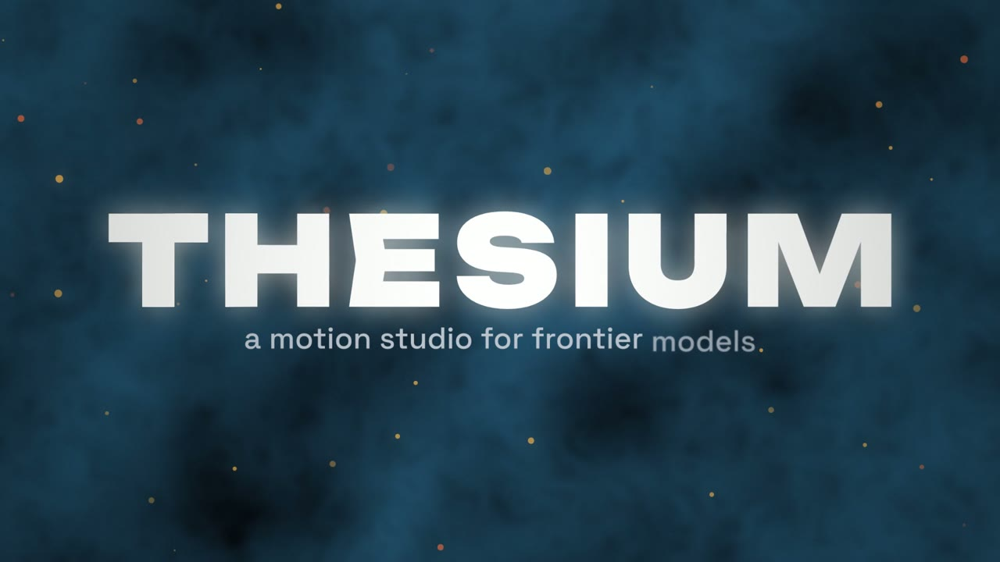
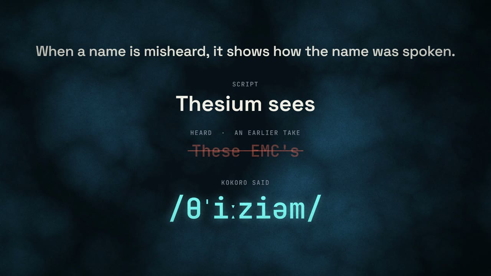

# Thesium

**An engine-agnostic motion studio for frontier models.** You describe a film; the model directs,
designs, animates and scores it in code, looks at its own frames, fixes what it sees, and Thesium
masters a finished video. The renderer is interchangeable: the browser, EffectCraft, Remotion,
HyperFrames, or any tool with a command line.

> The engine should not decide how good the film is. The model does the creative work; Thesium
> gives it the same eyes, ears and quality gate on every engine.

## Made with Thesium

[](docs/media/thesium-launch-effectcraft.mp4)

**"Thesium"**, a 30-second launch film directed through Thesium on **EffectCraft**: fractal fog,
a playhead that carries through every shot, a lit 3D wall of real renders, liquid type, an original
score. [Watch it](docs/media/thesium-launch-effectcraft.mp4) · [its source and making-of](examples/thesium-launch/)

The same plan, assets and score, made again on the **web** engine
([watch](docs/media/thesium-launch-web.mp4) · [source](examples/thesium-launch-web/)). In each
pair of rows, EffectCraft is above and web below, at the same moments:

[](examples/thesium-launch-web/#comparison)

[](docs/media/thesium-voice.mp4)

**"Hears every word"**, 24 seconds with narration, on the web engine: the director cannot listen,
so the film is the hearing check itself, drawn from Thesium's own output for its voice-over (the
waveform, every word lit when Whisper heard it, the misheard name as phonemes, the music stepping
aside). Its master: voice 10 LU over the music, 54 of 54 words heard in the final mix.
[Watch it](docs/media/thesium-voice.mp4) · [source and making-of](examples/thesium-voice/)

## How it works

Thesium asks one thing of a renderer: **draw the frame at time `t`**. Everything else is Thesium's
and identical on every engine:

| | |
| --- | --- |
| **Material** | web pages captured as screenshots, text, brand cues and images with provenance; real QR codes; frame-accurate video clips |
| **Eyes** | exact stills (with the master's motion blur), strips across cuts, phone-size reading copies, contact sheets, low-res previews |
| **Ears** | original scores and SFX written in code (numpy synth), beat tracking, loudness and spectrum checks for sound the model cannot hear |
| **Voice** | narration spoken locally (Kokoro, the system voice, any TTS command or recorded takes) on the film's clock, then transcribed and checked word by word against the script, with the phonemes of anything misheard; music ducks under it automatically |
| **Gate** | contract checks, a determinism test (frames rendered in two orders must match), an automatic frame check for empty bands and flat fields, an on-screen language check, technical QA of the master, narration balance and intelligibility in the final mix |
| **Finish** | full-quality render, stems mixed and normalised to −14 LUFS, AAC peak guard, poster and review sheets |
| **Fresh eyes** | a critic subagent that did not make the film reviews it against a rubric and a craft floor |
| **Design** | the [blueprint](docs/BLUEPRINT.md): principles, the engine contract, every subsystem, measurements |
| **The person** | a local review studio: play any version, pin notes on the timeline (each saves its frame), tune the parameters the director exposed on a real frame |

## Engines

| Engine | The film is | Notes |
| --- | --- | --- |
| `web` | `film/index.html` with `window.render(t)` | Own Chrome DevTools Protocol renderer, parallel tabs, no Playwright |
| `effectcraft` | `film/build.jsx`, an After Effects-style script | Built headless into a project; fonts and comp settings verified on every build |
| `remotion` | a React project in `film/remotion/` | Uses the project's own Remotion CLI |
| `hyperframes` | an HTML + GSAP project in `film/hyperframes/` | Uses the HyperFrames CLI |
| `command` | command templates in `thesium.json` | Blender, Manim, Motion Canvas or your own renderer |

## Install

Requirements: Node 22.12+, FFmpeg (with ffprobe) on PATH, Chrome/Edge/Chromium for the web engine,
Python 3.10+ with numpy and scipy for scores and SFX, and whichever engine you want to use
(`thesium doctor` checks all of it). For narration, optionally `pip install kokoro-onnx` (local
voices; the 325 MB model downloads once) and `pip install faster-whisper` (the hearing check).

**As a Claude Code plugin** (the director skill, the critic subagent and the MCP server):

```
/plugin marketplace add GrimNej/Thesium
/plugin install thesium@thesium
```

**As a CLI** (any agent with a shell): `git clone https://github.com/GrimNej/Thesium && cd Thesium && npm link`.

**As an MCP server** (agents without a shell): `node /path/to/Thesium/cli/thesium.js mcp`.
Stills, strips and sheets come back as images.

Thesium has no runtime npm dependencies.

## Use

Ask Claude for a film ("a 30-second launch film for … in EffectCraft"). The skill takes it from
the brief to a master. Or from a terminal, in one command (runs a headless Claude Code director):

```
thesium make "a 30-second launch film for https://example.com, warm and cinematic" --engine effectcraft
```

Or drive the studio yourself:

```
thesium new my-film --engine effectcraft --size 16:9 --duration 30 --title "My film"
cd my-film
node thesium.mjs guide          # the engine's contract and recipes
node thesium.mjs capture https://example.com   # real material: screenshots, text, brand, images
node thesium.mjs still 1.5 4    # look at frames
node thesium.mjs preview        # the whole film, low-res, with sheets and the frame check
node thesium.mjs check          # contract, rules, determinism
node thesium.mjs master         # out/my-film-v1.mp4
node thesium.mjs studio         # review, pin notes, tune parameters
```

`node thesium.mjs help` lists every command.

## Repository

```
cli/            the thesium command
src/core/       manifest (thesium.json), film workspaces, paths, vendored libraries
src/engines/    web, effectcraft, remotion, hyperframes, command: the engine contract
src/render/     stills, strips, motion blur and videos on any engine
src/media/      FFmpeg: sheets, encoding, mastering
src/review/     frame check, language check
src/studio/     operations shared by CLI, MCP and the review studio (+ its page)
src/mcp/        the MCP server
kit/            copied into every film: web motion kit, EffectCraft T kit, synth
knowledge/      the Motion Library: direction, craft, review, sound, 18 video types,
                43 style bibles, and a guide per engine
skills/ agents/ .claude-plugin/   the Claude Code plugin
fonts/          OFL fonts (+ fixed-weight instances for engines that need them)
docs/           build log and design documents
```

## Status

Early and moving fast. See [docs/PROGRESS.md](docs/PROGRESS.md) for what is built, what was
verified, and what comes next.

## Credits

Thesium grew out of Vmotion. Its Motion Library adapts work by xilo (@xilo2991), Kianzzz
(xilo-opus-video, MIT), LemoLab (Lemo-Opuscar style bibles, MIT), athemeroy (CC BY 4.0),
yihui-dev (MIT) and makevoid (MIT); see [knowledge/THIRD_PARTY.md](knowledge/THIRD_PARTY.md).
QR codes come from Project Nayuki's QR Code generator (MIT). Fonts are SIL Open Font License 1.1 ([fonts/README.md](fonts/README.md)). EffectCraft, Remotion
and HyperFrames are separate projects under their own licences; Thesium only calls them.

## License

MIT
