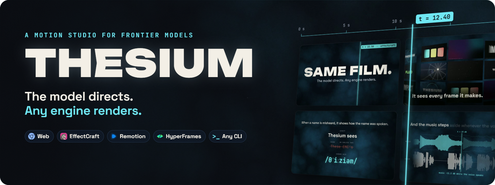
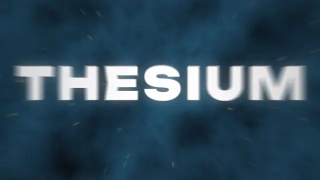
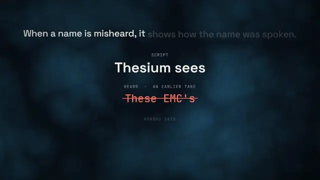
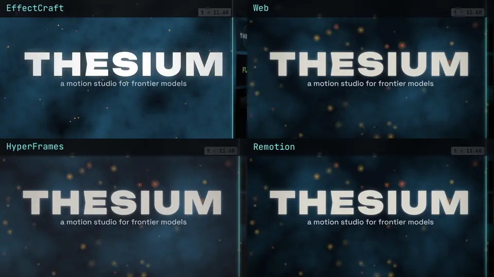
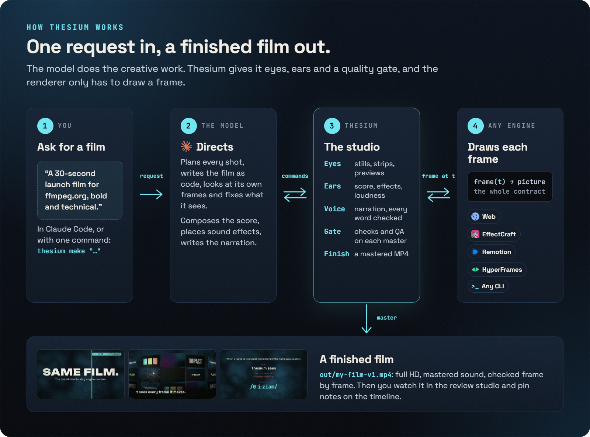

<p align="center">
  
</p>

<p align="center">
  <b>An engine-agnostic motion studio for frontier models.</b><br>
  You describe a film. The model directs it in code, looks at every frame, fixes what it sees,<br>
  and Thesium masters it on whichever engine you choose.
</p>

<p align="center">
  <a href="https://github.com/GrimNej/Thesium/actions/workflows/test.yml"></a>
  <a href="https://github.com/GrimNej/Thesium/releases"></a>
  <a href="LICENSE"></a>
  
  
  
</p>

<p align="center">
  <a href="https://claude.com/claude-code"></a>
  <a href="https://modelcontextprotocol.io"></a>
  <a href="https://nodejs.org"></a>
  <a href="https://ffmpeg.org"></a>
  <a href="https://www.chromium.org"></a>
  <a href="https://www.python.org"></a>
  <a href="https://huggingface.co/hexgrad/Kokoro-82M"></a>
  <a href="https://github.com/SYSTRAN/faster-whisper"></a>
</p>

<p align="center">
  <a href="knowledge/engines/web.md"></a>
  <a href="https://github.com/storytold/effectcraft"></a>
  <a href="https://www.remotion.dev"></a>
  <a href="https://github.com/heygen-com/hyperframes"></a>
  <a href="knowledge/engines/command.md"></a>
</p>

<p align="center">
  <a href="#quick-start"><b>Quick start</b></a> ·
  <a href="docs/GUIDE.md"><b>Guide</b></a> ·
  <a href="#made-with-thesium"><b>Films</b></a> ·
  <a href="#how-it-works"><b>How it works</b></a> ·
  <a href="docs/BLUEPRINT.md"><b>Blueprint</b></a>
</p>

---

## Made with Thesium

<table>
  <tr>
    <td width="50%"><a href="docs/media/thesium-launch-effectcraft.mp4"></a></td>
    <td width="50%"><a href="docs/media/thesium-voice.mp4"></a></td>
  </tr>
  <tr>
    <td><b>Thesium</b>: a 30-second launch film on EffectCraft. Fractal fog, a playhead through every shot, a lit 3D wall of real renders, liquid type and an original score.<br><a href="docs/media/thesium-launch-effectcraft.mp4">Watch</a> · <a href="examples/thesium-launch/">Source and making-of</a></td>
    <td><b>Hears every word</b>: a 24-second narrated film, drawn from Thesium's own check of its voice-over. Every word heard, the music stepping aside.<br><a href="docs/media/thesium-voice.mp4">Watch</a> · <a href="examples/thesium-voice/">Source and making-of</a></td>
  </tr>
</table>

<p align="center">
  <a href="examples/thesium-launch-web/#comparison"></a>
  <br><b>One film, four engines.</b> The launch film made again on the web engine, HyperFrames and Remotion from the same plan, assets and score.
  <a href="examples/thesium-launch-web/#comparison">Compare them</a>.
</p>

## Quick start

You need [Node.js](https://nodejs.org) 22.12+, [FFmpeg](https://ffmpeg.org/download.html) and Chrome (or Edge, or Chromium). Then, in [Claude Code](https://claude.com/claude-code):

```
/plugin marketplace add GrimNej/Thesium
/plugin install thesium@thesium
```

and ask for a film:

> Make a 20-second launch film for https://example.com, warm and cinematic, in EffectCraft.

Or from any terminal:

```
git clone https://github.com/GrimNej/Thesium && cd Thesium && npm link
thesium doctor                                   # checks your machine, says how to fix anything missing
thesium make "a 20-second launch film for https://example.com" --engine effectcraft
```

The model plans, builds, checks, scores and masters the film on its own, has an independent critic review it, and makes a polish pass. In testing, `thesium make` built a 12-second promo from a public website this way in about 45 minutes. Then open the review studio in the film's folder with `node thesium.mjs studio`, pin notes on the timeline, and hand them back. **The [guide](docs/GUIDE.md) walks through all of it, with pictures.**

## How it works

<p align="center"></p>

Thesium asks one thing of a renderer: **draw the frame at time `t`**. Everything else is the same on every engine:

| Sense | What Thesium gives the model |
| --- | --- |
| **Eyes** | exact stills with the master's motion blur, strips across cuts, phone-size copies, contact sheets, quick previews |
| **Ears** | original scores and sound effects written in code, beat tracking, loudness and spectrum checks |
| **Voice** | narration spoken locally, then transcribed and checked word by word; the music steps aside for it |
| **Gate** | rule checks, a same-frame-twice test, an automatic frame check, master QA, an independent critic |
| **Material** | web pages captured with their sources, real QR codes, frame-accurate video clips |
| **Finish** | full-quality render, sound mixed to −14 LUFS, review sheets |
| **You** | a local review studio: watch any version, pin notes to frames, tune what the film exposes |

## Engines

| Engine | The film is | Best for |
| --- | --- | --- |
| **Web** | a page with `window.render(t)` | anything a browser draws: WebGL, canvas, CSS 3D, SVG, video |
| **[EffectCraft](https://github.com/storytold/effectcraft)** | an After Effects-style script | classic motion design: effects, glows, lights, text animators |
| **[Remotion](https://www.remotion.dev)** | a React project | long films from reusable components and data |
| **[HyperFrames](https://github.com/heygen-com/hyperframes)** | HTML with a GSAP timeline | timeline choreography and HyperFrames' building blocks |
| **Any CLI** | commands in `thesium.json` | Blender, Manim, Motion Canvas, your own renderer |

Thesium calls each engine's own tools and bundles none of them. [Choosing an engine](docs/GUIDE.md#4-choose-an-engine) has the details.

## Documentation

| Read | For |
| --- | --- |
| [**Guide**](docs/GUIDE.md) | installing, your first film, notes, engines, sound and narration, troubleshooting |
| [Blueprint](docs/BLUEPRINT.md) | how Thesium is built and why, with measurements |
| [Engine guides](knowledge/engines/) | how a film is written for each engine, with tested recipes |
| [Motion Library](knowledge/README.md) | the director's craft: direction, review, sound, video types, style bibles |
| [Examples](examples/) | five films with their sources and what making them taught Thesium |
| [Build log](docs/PROGRESS.md) | what was built and verified |

<details>
<summary><b>Repository layout</b></summary>

```
cli/            the thesium command
src/core/       manifest (thesium.json), film workspaces, paths, disk checks
src/engines/    web, effectcraft, remotion, hyperframes, command: the engine contract
src/render/     stills, strips, motion blur and videos on any engine
src/media/      FFmpeg: sheets, encoding, mixing, ducking, mastering
src/review/     frame check, language check
src/studio/     everything the CLI, MCP server and review studio share, narration included
src/mcp/        the MCP server
kit/            copied into every film: web motion kit, EffectCraft kit, synth, voice
knowledge/      the Motion Library and a guide per engine
skills/ agents/ .claude-plugin/   the Claude Code plugin: director skill, critic, MCP
fonts/          OFL fonts (with fixed-weight instances for engines that need them)
docs/           guide, blueprint, figures and their sources, media, upstream reports
examples/       the films above, with their making-of
```

</details>

## Status

Version 1.0.0. All five engines are verified end to end, each with a master that passes QA, and the
films above were made with it. Tests run on every push on Linux (Node 22 and 24), and weekly on
Windows, macOS and Arch Linux (the base of Omarchy). Ideas for what comes next are in the [blueprint](docs/BLUEPRINT.md#18-roadmap).

## Credits

Thesium grew out of Vmotion. Its Motion Library adapts work by xilo (@xilo2991), Kianzzz
(xilo-opus-video, MIT), LemoLab (Lemo-Opuscar style bibles, MIT), athemeroy (CC BY 4.0),
yihui-dev (MIT) and makevoid (MIT); see [knowledge/THIRD_PARTY.md](knowledge/THIRD_PARTY.md).
QR codes come from Project Nayuki's QR Code generator (MIT). Fonts are SIL Open Font License 1.1
([fonts/README.md](fonts/README.md)). Narration uses Kokoro-82M (Apache-2.0) through kokoro-onnx
(MIT) and the hearing check faster-whisper (MIT), both installed by you and run locally. Icons in
the figures come from [Simple Icons](https://simpleicons.org) (CC0); product names and logos belong
to their owners. EffectCraft, Remotion and HyperFrames are separate projects under their own
licences; Thesium only calls them.

## License

[MIT](LICENSE)
