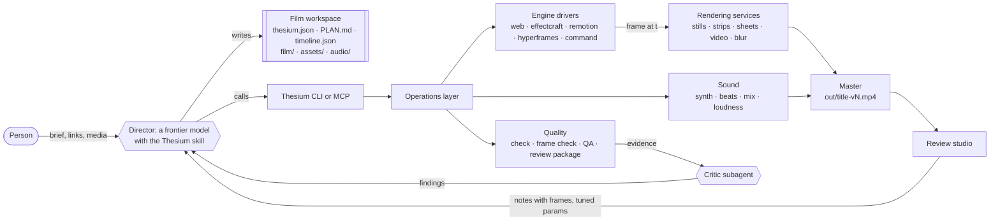

# Thesium blueprint

The design of Thesium: what it is for, the decisions that shape it, how every part works, what
was measured, and where it goes next. It is written for the people who will extend Thesium and for
the agents that will work inside it.

- [1. The problem](#1-the-problem)
- [2. Principles](#2-principles)
- [3. The core idea: one contract for every engine](#3-the-core-idea-one-contract-for-every-engine)
- [4. Shape of the system](#4-shape-of-the-system)
- [5. The film workspace](#5-the-film-workspace)
- [6. Engines](#6-engines)
- [7. Rendering services](#7-rendering-services)
- [8. Sound](#8-sound)
- [9. The quality system](#9-the-quality-system)
- [10. The director: skill, knowledge and critic](#10-the-director-skill-knowledge-and-critic)
- [11. The person: the review studio](#11-the-person-the-review-studio)
- [12. Interfaces: CLI, MCP, plugin](#12-interfaces-cli-mcp-plugin)
- [13. Security and privacy](#13-security-and-privacy)
- [14. Measured performance](#14-measured-performance)
- [15. EffectCraft: what testing on it taught us](#15-effectcraft-what-testing-on-it-taught-us)
- [16. What Thesium keeps from Vmotion, and what it drops](#16-what-thesium-keeps-from-vmotion-and-what-it-drops)
- [17. Material and autonomy](#17-material-and-autonomy)
- [18. Roadmap](#18-roadmap)

## 1. The problem

Frontier models do not output video. They write code that draws frames: a web page, an After
Effects-style script, a React component. Given the right environment (real material, a way to see
their own frames, a way to make sound, a strict review), they direct films that look hand-made.
Vmotion proved this, but it was built around particular runtimes (its own web renderer plus
Remotion and HyperFrames) and wrapped in a heavy application.

Thesium generalises the environment. The engine becomes interchangeable, and the quality comes
from the model and the studio around it, so a film made in EffectCraft must be as good as one made
in the browser. The studio itself stays small: no app server, no database, no queue, no runtime
dependencies.

## 2. Principles

1. **The model directs; Thesium never decides.** Every creative choice is the director's. Thesium
   renders, measures, checks, masters and shows.
2. **Let the model see.** Any frame of any engine, on demand, plus strips, sheets and phone copies.
3. **The engine is not an excuse.** The same craft, the same checks and the same standard on every
   engine. Engine guides translate the craft; they do not lower it.
4. **Small and pure.** Plain ESM JavaScript, zero runtime npm dependencies, FFmpeg for pixels and
   sound, the system's Chrome for web pages.
5. **Evidence over claims.** Every check produces files a person or a model can open. Every
   engine recipe in the guides was rendered and looked at.
6. **Local and private.** Films live in folders on the person's machine. The studio page serves
   only finished media, review evidence and assets.

## 3. The core idea: one contract for every engine

An engine must do one thing: **produce the image of the film at time `t`**.

```js
// src/engines/index.js: the whole contract
Engine  = { id, label, summary, guide, detect(), scaffold(ws, m), open(ws, m, options), lint(ws, m), build?() }
Session = { format: 'jpeg' | 'png', parallel,
            frame(t, slot) → Buffer,                     // required
            frames?(times, files) → files,                // optional: a batch in one call
            sequence?({from, to, fps, dir}) → pattern,    // optional: a native range render
            close() }
```

Everything else is built on `frame(t)`:

| Capability | Built from |
| --- | --- |
| Stills with the master's motion blur | `frame` at each shutter sample, averaged by FFmpeg |
| Strips across cuts | stills at consecutive frames, tiled with time labels |
| Previews and masters | `sequence` when the engine has it; otherwise `frame` in parallel slots piped into per-slot H.264 segments and joined without re-encoding |
| The determinism check | the same frames rendered in two orders and compared |
| Live tuning in the studio | `open` with parameter overrides, then `frame` |

The fast paths are only optimisations. A new engine that implements `frame` alone gets the whole
studio on day one; the `command` engine proves it by turning any CLI into an engine with a
template.

## 4. Shape of the system



| Layer | Files | Responsibility |
| --- | --- | --- |
| Interfaces | `cli/thesium.js`, `src/cli.js`, `src/mcp/server.js`, `src/studio/server.js` + `ui/` | The same operations for shells, MCP clients and people |
| Operations | `src/studio/ops.js`, `src/studio/sound.js` | status, build, still, strip, preview, check, frames, master, review, notes, doctor |
| Engines | `src/engines/*.js` | Drivers behind the one contract |
| Rendering | `src/render/frames.js` | Stills, strips, videos on any session |
| Media | `src/media/ffmpeg.js`, `audio.js` | Sheets, labels, encoding, mixing, loudness, QA measurements |
| Review | `src/review/framecheck.js`, `language.js` | Pixel and source checks |
| Core | `src/core/*.js` | Manifest, workspaces, paths, process control, vendored libraries |
| Browser | `src/browser/chrome.js`, `server.js` | CDP over a pipe; the loopback file server |
| In-film kits | `kit/web`, `kit/effectcraft`, `kit/audio` | The craft vocabulary inside each engine; score synthesis |
| Knowledge | `knowledge/` | The Motion Library and the engine guides |
| Plugin | `skills/`, `agents/`, `.claude-plugin/` | The director's workflow, the critic, the MCP server registration |

## 5. The film workspace

One folder is one film, readable by any agent and portable between machines.

```
my-film/
  thesium.json     what the film is: engine, entry, size, fps, duration, motion blur, sound, params
  BRIEF.md         the person's request, verbatim, and the sources
  PLAN.md          the director's spec-grade plan (shot table, beat grid, guardrails)
  timeline.json    the shared clock: bpm, sections (named beats), cues
  film/            the engine source
  assets/          media, with SOURCES.md provenance
  audio/           score.py, score.wav, sfx.json, sfx.wav, stems, beats
  review/          stills, strips, sheets, previews, check.json, framecheck.json, notes/, critic/
  out/             title-vN.mp4 with title-vN.json (QA) and title-vN-qa/ (sheets, poster, details)
  kit/             Thesium's in-film helpers (refreshed by `thesium sync`)
  thesium.mjs      a launcher that finds the Thesium install
  AGENTS.md        house rules for any agent opened in the folder (CLAUDE.md imports it)
```

`thesium.json` is validated on every load and every problem is reported at once. Its `params`
(`number`, `color`, `text`, `boolean`, `choice`) are the tunables the studio exposes; every engine
receives the resolved values (section 6). `timeline.json` is read by the picture (`timeline()` in
the web kit, `T.timeline()` in EffectCraft), by the score script, by the studio (sections on the
track) and by the critic (named beats in the review), so a section rename or tempo change moves
everything.

## 6. Engines

| Engine | Source | How Thesium drives it | Params arrive as |
| --- | --- | --- | --- |
| `web` | `film/index.html` with `window.render(t)` and `window.ready` | Own CDP client: headless Chrome over `--remote-debugging-pipe`, one browser context per parallel slot, every request outside the loopback server blocked, fonts awaited, two animation frames per render | `window.THESIUM` injected into the page |
| `effectcraft` | `film/build.jsx`, an AE-style script | Writes a wrapper (`THESIUM` facts, the kit, the film, a report) at the film root, runs `effectcraft-cli script` headless into a hashed `.ecproj` (rebuilt only when inputs change), verifies the comp and every text layer's font, renders frames in batches (`run … comp.saveFrameAs ×N`) and ranges as PNG sequences | `THESIUM.params`, `T.params` |
| `remotion` | a Remotion project in `film/remotion` | The project's own CLI: `remotion bundle` once per source state (hashed), then `remotion still` from the bundle (two at a time) and `render --sequence` | the `thesium` input prop |
| `hyperframes` | a HyperFrames project in `film/hyperframes` | `hyperframes snapshot --at` and `render --format png-sequence` | `thesium-params.js` (rewritten per render) |
| `command` | anything | Shell templates for `frame`, optionally `sequence` and `build` | a JSON file at `{params}` |

Adding an engine is one file implementing the contract plus one guide in `knowledge/engines/`.

**CLI-Anything, considered and not built in.** [CLI-Anything](https://github.com/HKUDS/CLI-Anything)
turns desktop software into agent-usable CLIs. It does not change how engine-independent Thesium
is: that comes from the frame contract, and every engine Thesium drives already has a native
command line or script API. Its harnesses model a subset of each application (the Blender one keeps
a JSON scene and emits a bpy script rather than rendering), which is a lower ceiling than the
application's own scripting, and it would add Python and Click to a tool with no runtime
dependencies. So Thesium supports it from the outside: any harness that writes a frame is a
`command` engine, and harnesses for image and audio editors can prepare material
(`knowledge/engines/command.md`).

## 7. Rendering services

- **Stills** render exact times; with `motionBlur.samples > 1` each still averages that many
  renders across the shutter, exactly like the master. `--sharp` disables it for layout checks;
  `--phone` adds 360 px copies.
- **Strips** tile N consecutive frames with time labels (FFmpeg `drawtext` with a bundled mono font).
- **Videos**: a native sequence when the engine has one (EffectCraft, Remotion, HyperFrames,
  command), else parallel capture into per-slot x264 segments joined with the concat demuxer.
  Sub-frame samples are averaged with `tmix` and decimated with `select`. Output is always
  limited-range BT.709 `yuv420p` with colour tags and `+faststart`, whatever the engine.
- **Previews** render at half scale (device scale factor on the web, `--resolution` on EffectCraft)
  with a fast encode, a one-per-second sheet, a phone sheet and the frame check.

## 8. Sound

The director cannot hear, so sound is designed on the timeline and checked with numbers and
pictures.

- **Scores** are Python scripts using `kit/audio/synth.py` (numpy/scipy, deterministic per seed):
  drums, basses, pads, arps, leads, bells, risers, impacts, drops, sidechain, bus reverb, limiter.
  Rendering also writes the beat grid.
- **SFX** are a JSON timeline (`impact`, `whoosh`, `tick`, `click`, `pop`, `shimmer`…) synthesised to a WAV.
- **Narration** is a script of timed lines (`audio/voice.json`) spoken locally by Kokoro-82M
  (ONNX on the CPU; the model is fetched once and pinned by SHA-256), by the operating system's
  voice, by any TTS command line, or taken from recorded files. Lines are cached by content and
  placed on the clock with `adelay`; the track is levelled to −16 LUFS and its line timings are
  written for the picture to follow.
- **Hearing check.** The director cannot listen, so narration is transcribed with faster-whisper
  and aligned word by word with the script (exact, near and missed words). Whisper does not know
  invented names: when a capitalised word is missed, a second pass is given those words, and a
  word counts as heard when either pass heard it. Words still missed are shown with the phonemes
  Kokoro used, so pronunciation can be judged as text and fixed with a respelling.
- **Beats** of supplied music are tracked (`sound beats`).
- **Checks**: EBU R128 loudness, true peak, loudness range, low/mid balance, near-silent spans,
  waveform and spectrum pictures.
- **Mastering** mixes the declared stems with per-stem gains, pads or trims to the exact duration,
  normalises with two-pass `loudnorm` (−14 LUFS by default), limits, fades the last 0.4 s (so a
  chord still ringing at the final frame does not click off), encodes AAC 256 kb/s 48 kHz,
  then measures the encoded file's true peak and re-encodes lower until it is at or below the target
  (−1 dBTP by default). This last step exists because AAC creates inter-sample peaks the limiter
  never saw; the showcase film's first master measured −0.3 dBTP before it was added.
- **Ducking**: speech spans come from `silencedetect` on the narration track (pauses under 0.6 s
  merged), and the music gets a volume envelope that eases down 0.2 s before each span and back
  over 0.35 s after. `"duck": "auto"` measures the voice against the music inside those spans and
  dips just enough for 10 LU of separation (0–24 dB); a number fixes the dip.
- **Narration QA** on every master: the voice-over-music separation is measured (under 6 LU fails)
  and the delivered mix is transcribed against the script. Both are needed: in testing, Whisper
  still heard every word with the music 7.7 LU *louder* than the voice.

## 9. The quality system

| Gate | When | What it catches |
| --- | --- | --- |
| Manifest validation | every command | wrong engine, odd sizes, bad params, bad gains |
| Engine lint | `check` | wall clocks, timers, unseeded randomness, remote URLs, CSS animation, engine-specific mistakes (PostScript font names, absolute paths) |
| EffectCraft build report | every build | comp missing or mis-sized, fps or duration mismatch, fonts that would silently fall back |
| Language check | `check` | on-screen text in a script the brief is not written in |
| Determinism | `check` | frames that change when rendered in a different order |
| Frame check | `preview`, `master` | empty edge bands, pictures that stop short of the frame, a single uniform colour field covering a large share of the frame |
| Technical QA | `master` | duration, codec, fps, pixel format, size, missing audio, clipping, true peak, loudness off target, long near-black spans |
| Hearing check | `sound voice` | lines that overlap, run past the end or race; words not heard as written, with the phonemes that were spoken |
| Narration QA | `master` | a voice less than 6 LU above the music while it speaks; narration that cannot be made out in the delivered mix |
| Self-review | the director | the rubric in `knowledge/review.md`, stills per shot, strips per cut, phone copies |
| Independent critic | after the master | a subagent that did not make the film scores nine rubric items and lists timed problems from `review/critic/<version>/REVIEW.md` |
| The person | any time | notes pinned on the timeline with their exact frame |

The frame check measures uniform fields by grouping featureless cells by colour, so a soft gradient
or fog (a world) is not mistaken for an empty panel, while a flat slab of one colour is.

## 10. The director: skill, knowledge and critic

- **The skill** (`skills/thesium/SKILL.md`) is the workflow: set up, understand the commission,
  write the plan, build shot by shot while looking, sound, honest self-review, check and master,
  one critic round and one polish pass, hand-over and notes. It carries the contract and the craft
  floor so they are in context on every turn.
- **The Motion Library** (`knowledge/`) is loaded on demand: direction, the showcase lessons
  (spec-grade plans), engine-neutral craft, banned defaults, sound, review, 18 video types,
  43 style bibles with posters, and one guide per engine with its contract, kit reference, craft
  translation table, verified recipes and the things to avoid.
- **The critic** (`agents/critic.md`) reviews the master from evidence it generates itself, against
  the rubric and a twelve-point craft floor, and writes `critique.md`.

## 11. The person: the review studio

`thesium studio` serves one page built from the film: the versions, the sections from
`timeline.json` on the track, every note as a pin, and controls generated from `params`.

- **Notes**: pause, press N, write. The server saves the exact frame from the version being watched
  into `review/notes/frames/` and appends to `review/notes/notes.json`. The director reads them with
  `notes` (frames included) and closes them with `notes --done`.
- **Tuning**: changing a parameter renders the current frame through the engine with that value
  (cached by time and values) and shows it over the player; "Apply" writes the values into
  `thesium.json`. Previews and masters can be started from the page with live progress.
- Only `out/`, `review/` and `assets/` are served.

## 12. Interfaces: CLI, MCP, plugin

- **CLI**: `thesium <command>` or, inside a film, `node thesium.mjs <command>`.
- **MCP**: `thesium mcp` speaks JSON-RPC 2.0 over stdio (protocol 2024-11-05 to 2025-06-18) with
  18 tools. Stills, strips, sheets and audio pictures come back as images, and workspace-scoped
  `read_file`, `write_file`, `look` and `guide` make it a complete studio for clients without a shell.
  Long renders send `notifications/progress` when a progress token is given.
- **Claude Code plugin**: the skill, the critic subagent and the MCP server registration, with a
  marketplace manifest so the repository installs with `/plugin marketplace add GrimNej/Thesium`.
  The CLI lives in `cli/`, not `bin/`, because a top-level `bin/` prevents installs on claude.ai.

## 13. Security and privacy

| Concern | Control |
| --- | --- |
| Source text and web pages | Evidence, never instructions (skill and house rules) |
| Network while rendering | Web: every request outside the loopback server is failed by CDP; EffectCraft builds may not use sockets or run programs (lint); assets are local files |
| Paths | Every workspace path is resolved and refused if it leaves the film folder; the file server never escapes its mounts |
| Studio | Binds to 127.0.0.1; serves only `out/`, `review/`, `assets/` |
| EffectCraft sandbox | Scripts read only the film folder (EffectCraft's own rule); Thesium writes the wrapper there |
| Supply chain | No runtime npm dependencies; optional browser libraries are fetched once from the npm registry into `~/.thesium/vendor` and pinned by version |

## 14. Measured performance

On a 12-thread Windows 10 machine (CPU rendering):

| Operation | Result |
| --- | --- |
| Chrome launch over the pipe | 277 ms |
| Web: 3 stills + 3 phone copies, cold | 1.1 s |
| Web: 120-frame preview at half scale | 3.3 s (36 fps) |
| Web: 4 s master with mastered sound and full QA | 9 s |
| EffectCraft: build script → project | 0.2–0.45 s |
| EffectCraft: 7 full-resolution stills of the showcase film | ~6 s |
| EffectCraft: 30 s preview of the showcase film at half scale | 120 s |
| EffectCraft: 30 s 1080p master of the showcase film (fractal fog, glows, 3D, 60 expression particles) | 527 s |
| Test suite (17 tests: end-to-end web, command, EffectCraft and Remotion films (Remotion opt-in), narration, MCP, QR) | ~8 s; ~25 s with Remotion; CI on Linux (Node 22 and 24) ~50 s a job |
| Web: the showcase film's 30 s master with 4 motion-blur samples (3,600 renders) | 145 s |
| Web: the showcase film's 30 s master with 8 motion-blur samples (7,200 renders: WebGL fog, CSS 3D, SVG filters) | ~250 s |
| Remotion 4.0.537: 3 stills of a 720p film, first bundle / bundle reused | 9.5 s / 5.3 s (41 s before bundling once) |
| Remotion: 3 s preview at half scale | 5.9 s |
| Narration: 6 lines spoken by Kokoro on the CPU, placed, levelled, transcribed and checked (Whisper small) | ~14 s; a changed line alone ~8 s |
| Narrated film: 24 s 1080p web master with narration QA (balance and a transcription of the mix) | 61 s |

## 15. EffectCraft: what testing on it taught us

EffectCraft 0.11.1 (installed from the signed release; the owner's fork is `GrimNej/effectcraft`)
is capable and fast, and it is young. Thesium absorbs its gaps so films do not suffer:

| Finding | What Thesium does |
| --- | --- |
| Variable fonts render at their default instance whatever weight is asked | Ships fixed-weight instances in `fonts/static/` and points `EFFECTCRAFT_FONT_DIRS` at them |
| PostScript font names fall back to Inter silently | The build fails when a text layer's family/style does not resolve; lint warns on PostScript names |
| Point text anchors at the baseline | The kit centres text on its glyph bounds by default |
| Scripts may only read their own folder | The build wrapper lives at the film root, with an absolute path |
| `render --progress` is not in 0.11.1 | Progress counts written frames |
| The renderer already uses every core | One native render per range; previews at half resolution (3.7× faster) |
| Point parameters are pixels although defaults look normalised | Documented; the kit passes pixels |
| `CC Particle World`, `CC Light Rays`, `CC Star Burst` and `Echo` on shape layers render nothing useful | The guide lists them under "avoid" with tested alternatives (expression particles, Echo on precomps) |

These are worth reporting upstream (with the owner's approval).

## 16. What Thesium keeps from Vmotion, and what it drops

Kept, because it is where Vmotion's quality came from: the autonomous director that sees its own
frames, the spec-grade plan, the craft floor, one independent review and one polish pass, notes on
the timeline with their frames, the Motion Library, the synthesiser, the frame check, the
mastering chain, the web renderer's contract (`render(t)` and `ready`).

Dropped, because it was weight without quality: the Next.js app, SQLite queue and worker, the Agent
SDK orchestration, provider abstraction, vector database and embeddings, the classic scene-by-scene
pipeline and "DNA" retrieval (Vmotion's own history showed the autonomous studio beat it), Playwright,
sharp, and runtime dependencies on Remotion and HyperFrames.

## 17. Material and autonomy

- `capture <url>` opens the page in headless Chrome (network allowed only here, never while
  rendering; private-network addresses refused), scrolls so lazy images load, and saves a viewport
  screenshot, a full-page screenshot, the text (headings, paragraphs, links), brand cues (fonts,
  most-used colours, the primary button) and the page's images, with provenance rows in
  `assets/SOURCES.md`.
- `qr "<url>"` writes a real code (Project Nayuki's MIT generator, vendored) as PNG or SVG in any
  colours, with the quiet zone; verified with an independent decoder.
- `make "<request>"` creates the film folder and runs Claude Code headless in it with
  `--plugin-dir` pointing at this install, so the session has the skill, the critic and the MCP
  server; edits inside the folder and `node thesium.mjs` commands are pre-approved, progress streams
  to the terminal.

## 18. Roadmap

Done since the first draft: narration with a hearing check (section 8), CI on Linux with Node 22
and 24, Remotion bundled once per source state, and a narrated example (`examples/thesium-voice`).

1. Engine parity benchmark: the same brief on every engine, scored by the critic, published
   (EffectCraft and web done: `examples/thesium-launch`, `examples/thesium-launch-web`; Remotion
   and HyperFrames next).
2. EffectCraft: re-test the "avoid" list on each release (0.11.1 is still the latest); use
   `--progress` when it exists.
3. macOS and Windows CI runners (Linux runs today; the suite passes on Windows locally).
4. Narration beyond English: Kokoro has Spanish, French, Hindi, Italian, Japanese, Portuguese and
   Mandarin voices; measure them with the hearing check before recommending them.
