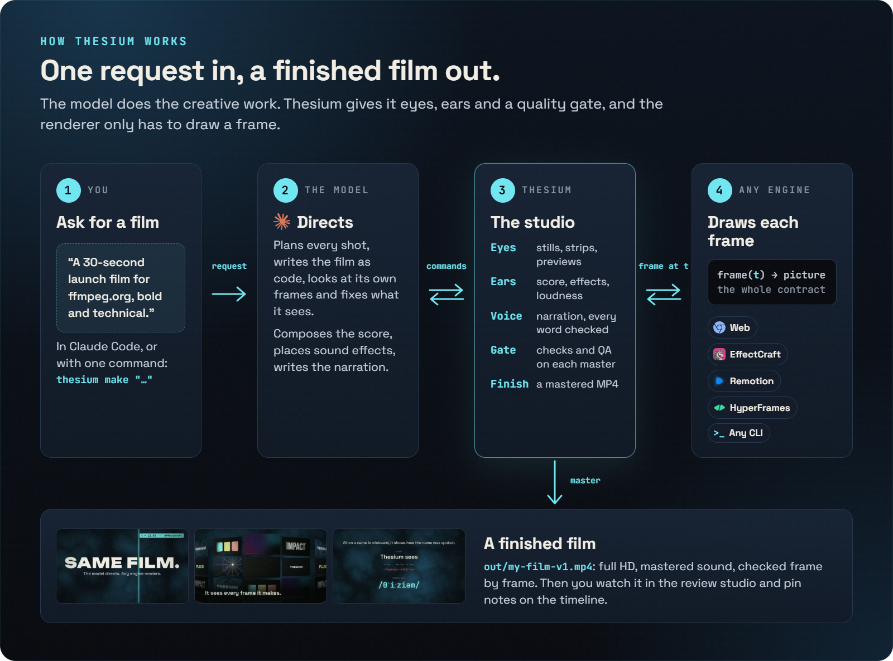
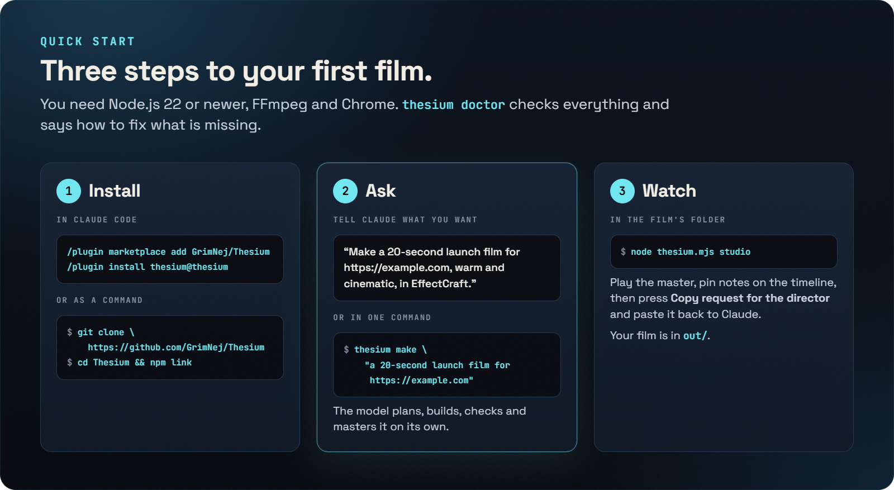
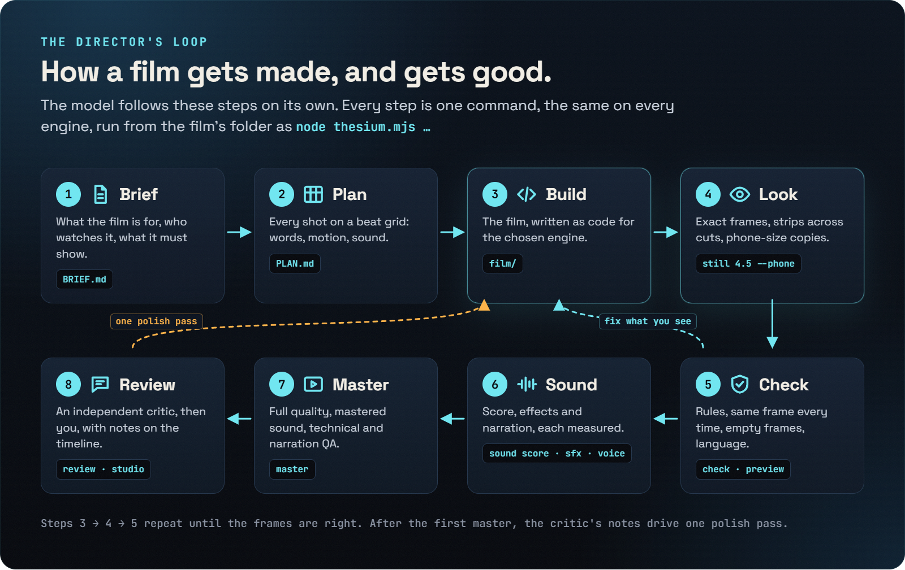
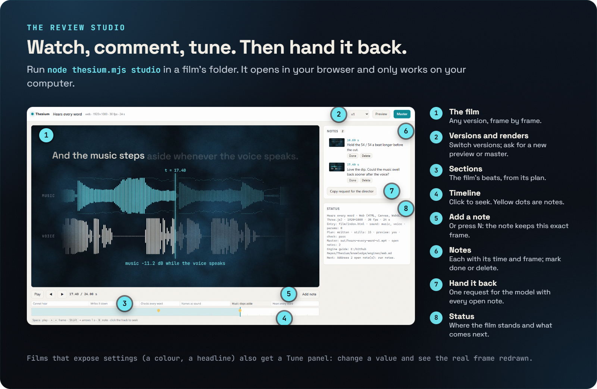
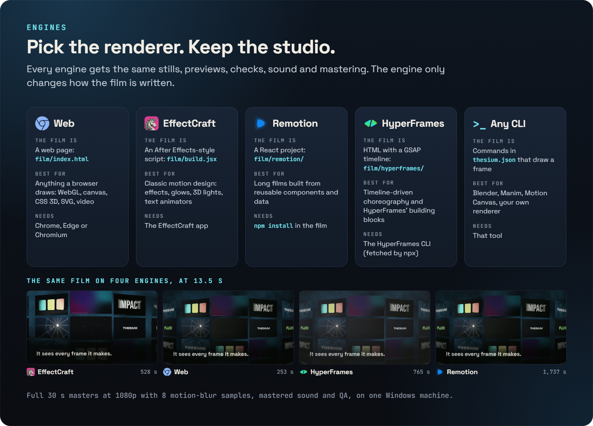
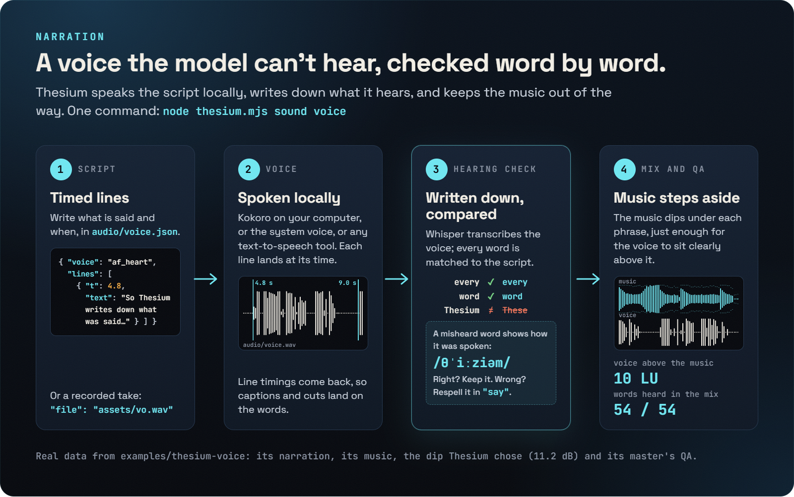
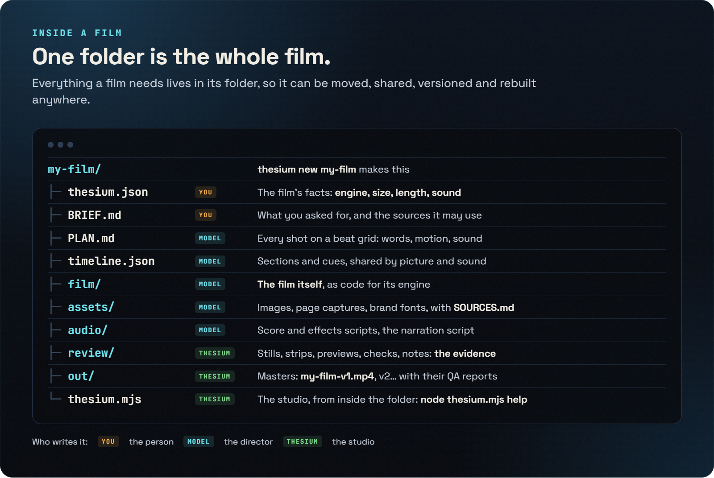
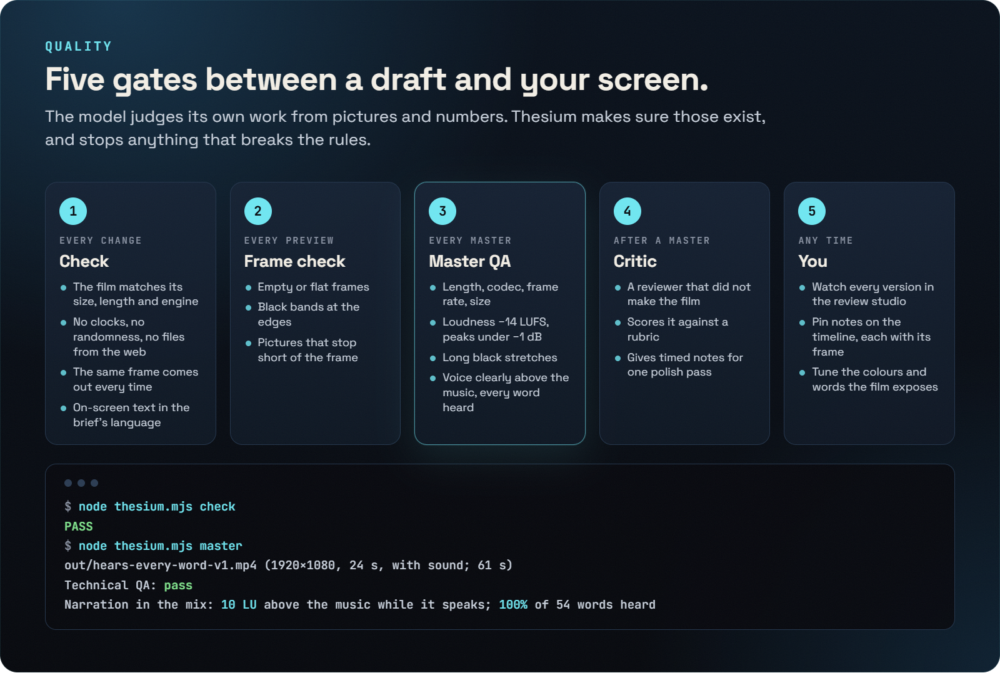

# The Thesium guide

Everything you need to make a film with Thesium, in the order you will need it. Each part starts
with a picture; the text says what the picture leaves out.

1. [Install](#1-install)
2. [Make your first film](#2-make-your-first-film)
3. [Watch it and give notes](#3-watch-it-and-give-notes)
4. [Choose an engine](#4-choose-an-engine)
5. [Sound and narration](#5-sound-and-narration)
6. [Inside a film](#6-inside-a-film)
7. [How quality is kept](#7-how-quality-is-kept)
8. [Driving the studio yourself](#8-driving-the-studio-yourself)
9. [Troubleshooting](#9-troubleshooting)
10. [Questions](#10-questions)



---

## 1. Install



**What your computer needs**

| | Needed for | Get it |
| --- | --- | --- |
| Node.js 22.12 or newer | everything | [nodejs.org](https://nodejs.org) |
| FFmpeg (with ffprobe) | everything | [ffmpeg.org](https://ffmpeg.org/download.html), or `winget install ffmpeg`, `brew install ffmpeg`, `apt install ffmpeg` |
| Chrome, Edge or Chromium | the web engine, page capture, figures | usually already there |
| Claude Code | the model that directs | [claude.com/claude-code](https://claude.com/claude-code) |
| Python 3.10+ with numpy and scipy | original music and sound effects | `pip install numpy scipy` |
| kokoro-onnx, faster-whisper | narration and its hearing check (optional) | `pip install kokoro-onnx faster-whisper` |
| EffectCraft, Remotion, HyperFrames | only the engine you choose | see [Choose an engine](#4-choose-an-engine) |

Then check it all at once:

```
thesium doctor
```

Each line says `ok` or `miss`, and every `miss` says how to fix it. Thesium itself has no npm
dependencies to install.

**Three ways to install**

- **In Claude Code (recommended).** Run `/plugin marketplace add GrimNej/Thesium`, then
  `/plugin install thesium@thesium`. Claude gets the director skill, the critic and the studio tools.
- **As a command.** `git clone https://github.com/GrimNej/Thesium`, then `cd Thesium && npm link`.
  Now `thesium` works in any terminal, and any AI agent with a shell can use it.
- **As an MCP server**, for agents without a shell: point them at `node /path/to/Thesium/cli/thesium.js mcp`.
  Frames and sheets come back as images.

---

## 2. Make your first film

**Ask in Claude Code.** Describe the film the way you would to a motion designer: what it is for,
how long, the mood, any links it should use.

> Make a 20-second launch film for https://example.com, warm and cinematic, in EffectCraft.

**Or ask from a terminal**, and Thesium starts a Claude Code session for you:

```
thesium make "a 20-second launch film for https://example.com, warm and cinematic" --engine effectcraft --duration 20
```

Either way the model works on its own, following the loop below, and tells you where the finished
film is, what it could not check, and how to review it. In testing, a 12-second promo built from a
public website took about 45 minutes of the model's time, including the critic's review and one
polish pass; longer and richer films take longer.



If the session stops halfway (a usage limit, a closed terminal), pick it up where it stopped:

```
thesium make --continue --folder <the film's folder>
```

**What to put in the request.** The model is told to take names, prices, dates and claims only
from what you give it. Links are the easiest way to give it real material: it captures each page
(screenshots, text, colours, images) and records where everything came from.

---

## 3. Watch it and give notes



In the film's folder:

```
node thesium.mjs studio
```

Play the film, pause where something is wrong, press **N** and write what you want changed. Each
note keeps the exact frame it is about. When you are done, **Copy request for the director** and
paste it to Claude: it reads every note, fixes the film and masters a new version, which appears in
the studio's version list.

If the film exposes settings (an accent colour, a headline), the **Tune** panel shows them; change
one and the real frame redraws. **Apply to film** saves it in `thesium.json`, and the next preview
or master uses it. Masters are in `out/` as `<title>-v1.mp4`, `-v2.mp4` and so on.

---

## 4. Choose an engine



An engine is the program that draws the frames. Thesium gives every engine the same studio, so the
choice is about how the film is best written, not about quality:

- **Web** is the default and the quickest to set up: if a browser can draw it, it can be in the film.
- **EffectCraft** suits classic motion design: layers, effects, lights and cameras, written as an
  After Effects-style script. Install the [EffectCraft app](https://github.com/storytold/effectcraft/releases);
  Thesium finds it, or set `THESIUM_EFFECTCRAFT` to its `effectcraft-cli`.
- **Remotion** suits long films built from reusable React components. Each film installs its own
  Remotion: run `npm install` in `film/remotion` once.
- **HyperFrames** suits timeline choreography in HTML and GSAP. Thesium runs its CLI through `npx`,
  or a global `hyperframes` install.
- **Any CLI**: if a tool can draw one frame from the command line (Blender, Manim, your own
  renderer), describe the command in `thesium.json` and it becomes an engine.
  [The command guide](../knowledge/engines/command.md) shows how.

Pick one with `--engine` when you start. The same film was made on four of them; compare them in
[the parity example](../examples/thesium-launch-web/#comparison).

---

## 5. Sound and narration

Unless you ask for silence, the model writes an original score and places sound effects on the
moments that need them, then measures what it cannot hear: loudness, peaks, the balance of bass
and mids, waveforms. Every master is mixed to −14 LUFS with peaks under −1 dB, the level streaming
platforms expect.

To use your own music, put it in `assets/` and say so in the request; the model finds its beats and
cuts to them.



**Narration.** Ask for a voice-over and the model writes timed lines in `audio/voice.json`. Thesium
speaks them on your computer, places each at its time, and then writes down what it hears and
compares it with the script, word by word. You get back:

- each line's start and end, so captions and cuts land on the words;
- any line that runs into the next, past the end, or too fast;
- any word that was not heard as written, with how it was pronounced (`/θˈiːziəm/`), so a wrong
  pronunciation can be fixed by respelling it.

The music dips under every phrase on its own, just enough for the voice to sit clearly above it,
and each master checks that balance and listens to the final mix again.

| In `voice.json` | Means |
| --- | --- |
| `"voice": "af_heart"` | the voice; `node thesium.mjs sound voices` lists them. English, Spanish, French, Italian and Brazilian Portuguese are heard back at 92–100%; for Hindi, Japanese and Mandarin use the computer's voice or another tool (`"provider"`) |
| `"t": 4.8, "text": "…"` | a line and when it starts, in seconds |
| `"say": "…"` | how to pronounce it, when that differs from what is written |
| `"file": "assets/vo/take-3.wav"` | a recorded take instead of a synthetic voice |
| `"provider": "system"` or `"command"` | the computer's own voice, or any text-to-speech program |

---

## 6. Inside a film



A film is one folder. Copy it, put it in git, send it to someone: `thesium sync` inside it refreshes
Thesium's helper files on a new machine. The commands run from inside the folder:

| Command | What it does |
| --- | --- |
| `node thesium.mjs status` | where the film stands and what to do next |
| `node thesium.mjs still 4.5 12 --phone` | exact frames as pictures, with phone-size copies |
| `node thesium.mjs strip 8.0` | twelve frames in a row across a cut |
| `node thesium.mjs preview` | the whole film, quickly and at half size, with a contact sheet |
| `node thesium.mjs check` | every rule and the same-frame-twice test: PASS or FAIL |
| `node thesium.mjs sound score audio/score.py` | renders the score |
| `node thesium.mjs sound voice` | speaks and checks the narration |
| `node thesium.mjs master` | the finished film in `out/` |
| `node thesium.mjs review` | collects the evidence for the critic |
| `node thesium.mjs studio` | the review studio |
| `node thesium.mjs capture <url>` | a web page as material, with its sources |
| `node thesium.mjs qr "<url>"` | a real, scannable QR code |
| `node thesium.mjs help` | everything else |

---

## 7. How quality is kept



The model cannot watch the film the way you do, so it works from pictures and numbers, and
Thesium makes sure both exist at every step: stills and strips while building, a contact sheet and
a frame check with every preview, measured sound, and a full QA report with every master. After
the first master an independent critic, which did not make the film, reviews it against a rubric,
and the model makes one polish pass from its notes. Then it is your turn in the studio.

---

## 8. Driving the studio yourself

You do not need the model to use Thesium. Make a folder, write the film, and use the same tools:

```
thesium new my-film --engine web --duration 15 --title "My film"
cd my-film
node thesium.mjs guide        # how a film is written for this engine
```

Write `film/index.html` (or the engine's equivalent), then `still`, `preview`, `check` and
`master` as above. The engine guides in [`knowledge/engines/`](../knowledge/engines/) give the
contract and tested recipes for each engine; the [blueprint](BLUEPRINT.md) explains how every
part of Thesium works.

---

## 9. Troubleshooting

| You see | Do this |
| --- | --- |
| `miss ffmpeg` | Install FFmpeg and make sure `ffmpeg -version` works in a new terminal. |
| `No Chrome, Edge or Chromium found` | Install Chrome, or set `THESIUM_CHROME` to a Chromium-family browser. |
| `effectcraft-cli not found` | Install EffectCraft, or set `THESIUM_EFFECTCRAFT` to its `effectcraft-cli`. |
| `Remotion is not installed in film/remotion` | Run `npm install` in that folder once. |
| `The film never set window.ready = true` | The web page threw an error before it was ready; the message lists the page's errors. |
| `… needs about N GB of temporary space` | Free space on the temporary drive, or point `TEMP` (Windows) or `TMPDIR` to a larger one. |
| `Narration with Kokoro needs kokoro-onnx` | `pip install kokoro-onnx`; or set `"provider": "system"` for a quick guide track. |
| `Hearing check skipped` | `pip install faster-whisper` to have narration transcribed and checked. |
| A `make` session stopped halfway | `thesium make --continue --folder <film>` picks it up. |
| `check` says FAIL | Each finding names the file and the rule; the model fixes these itself when it runs the film. |

---

## 10. Questions

**Does the engine change how good the film looks?** It should not, and that is the point: the
[parity example](../examples/thesium-launch-web/#comparison) is one film made on EffectCraft, the
web, HyperFrames and Remotion.

**Does anything leave my computer?** The renders, the voice and the hearing check all run locally.
Page capture fetches the pages you name, and the model runs in Claude Code under your account. A
film renders from its own files only: the web engine blocks every request to the internet while it
renders, and the other engines' checks reject files that would be fetched from it.

**Can I use my own fonts, music, footage or voice?** Yes. Put them in `assets/` and mention them
in the request; the model records where each one came from in `assets/SOURCES.md`.

**Which sizes and lengths work?** Any: `--size 16:9`, `9:16`, `1:1` or `1920x1080`, at any frame
rate and length. Vertical films are checked at phone size like every other.

**Can other AI agents use it?** Yes. Any agent with a shell can run `thesium`; agents without one
can use the MCP server. The house rules each film carries (`AGENTS.md`) work for any agent.
