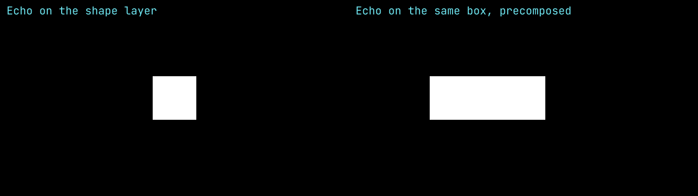

# EffectCraft issues, ready to file

Found while building Thesium on EffectCraft 0.11.1 (Windows 10, portable release) and re-verified
with minimal scripts that use no Thesium code: `node docs/upstream/effectcraft/repro.mjs` builds a
small project per case with `effectcraft-cli script`, renders frames with `effectcraft-cli run …
comp.saveFrameAs`, and measures them with FFmpeg. Results: [`results.json`](results.json).

**Not filed yet.** Each one waits for the repository owner's go-ahead, then goes to
[storytold/effectcraft/issues](https://github.com/storytold/effectcraft/issues) as written below.

---

## 1. Styles of a variable font do not set its weight

**Version** 0.11.1 · **Kind** bug

A text layer that asks for a named style of a variable font (`font: "Unbounded", style: "Black"`)
does not render at that weight. With only the variable file installed
([Unbounded](https://fonts.google.com/specimen/Unbounded), `wght` 200–900), "Black" renders far
lighter than Unbounded Black and "Light" heavier than Unbounded Light; with static instances
installed instead, both render correctly.

| Style asked | Variable file only | Static instance |
| --- | --- | --- |
| Black | mean luma 32.4 | 39.2 |
| Light | 29.2 | 25.8 |


**Repro**

```js
// EFFECTCRAFT_FONT_DIRS points at a folder holding only Unbounded.ttf (the variable font)
["Black", "Light"].forEach(function (s) {
  var c = app.project.items.addComp("Weight " + s, 1200, 400, 1, 1, 30);
  app.run("comp.open", { comp: c.id });
  app.run("layer.newText", { text: "Weight", font: "Unbounded", style: s, size: 150, fill: "#ffffff" });
});
```

**Expected** the named instance's `wght` (Black = 900, Light = 300), as After Effects does.
**Workaround** install static instances (Thesium ships them in `fonts/static/`).

---

## 2. A font that does not exist renders in Inter with no warning

**Version** 0.11.1 · **Kind** feature request

`layer.newText` with a family that is not installed (`font: "No Such Family"`) succeeds, and the
layer renders in Inter, pixel-identical to asking for Inter. Nothing in the script result, the
CLI output or the project says the font was replaced, so a typo or a missing file ships silently.

**Ask** a warning in the command's result (or an error under a strict flag), and a way to list
text layers whose font was substituted, like After Effects' missing-fonts list.
**Workaround** Thesium reads each text layer's resolved font back after a build and fails when it
differs from the one asked for.

---

## 3. Echo on a shape layer leaves no trail

**Version** 0.11.1 · **Kind** bug

`Echo` (Time) applied to a moving shape layer changes nothing: the frame is pixel-identical to the
same layer without it. Applied to the same shape precomposed, it trails as expected.

| Echo on | Difference with/without Echo (mean luma) |
| --- | --- |
| the shape layer | 0.000 |
| the same box, precomposed | 10.0 |



**Repro** a 80×80 rectangle keyed from x 100 to 540 over one second, `Echo` with
`numberOfEchoes: 6`, `echoTime: -0.05`, frame at 0.5 s (full script in `repro.mjs`, case 6).

**Expected** the trail the precomposed version shows. **Workaround** precompose the shape.

---

## 4. Progress output for `render`

**Version** 0.11.1 · **Kind** feature request

`effectcraft-cli render` prints nothing until it finishes, and a 30 s 1080p film with heavy effects
takes several minutes. A `--progress` option (frames done / total on stderr, or JSON lines with
`--json`) would let tools show progress and estimate time. Thesium currently counts the files
written to the output folder.

---

## Checked and not reported

An earlier note listed these as broken. Re-tested in isolation on 0.11.1, they work: CC Particle
World and CC Star Burst render particles and stars with their defaults, CC Light Rays renders its
rays, and a PostScript name (`Unbounded-Black`) resolves to the right face. Point text anchoring at
its baseline matches After Effects, and scripts reading only their own folder is a security
choice, so neither is a bug.
