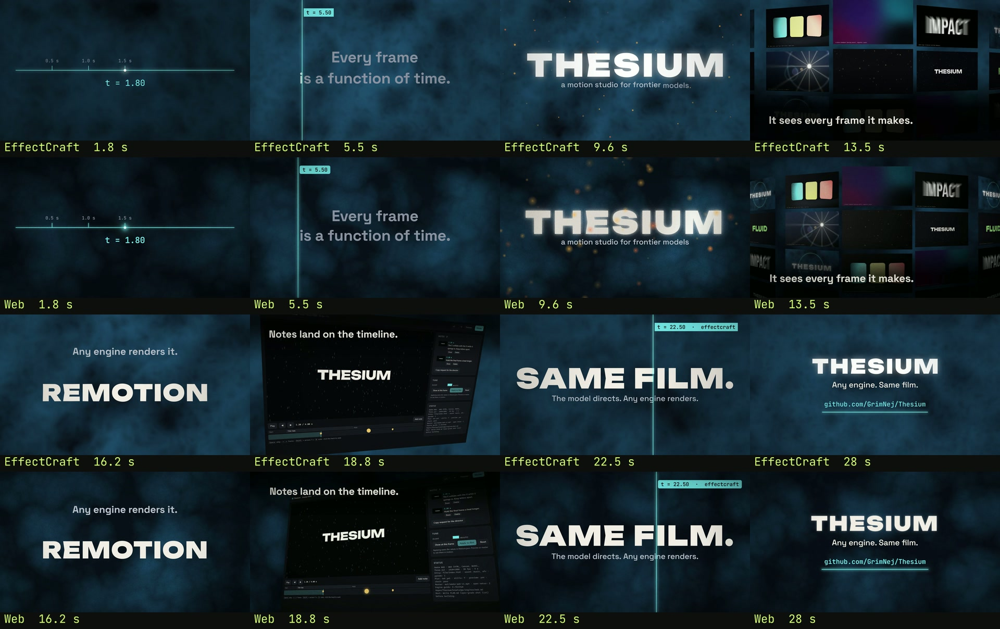

# Example: the same film on the web engine

The parity test behind Thesium's central claim: the engine should not decide how good the film
is. This folder makes [`examples/thesium-launch`](../thesium-launch/) again on the **web** engine,
from the same `PLAN.md`, `timeline.json`, assets, score and SFX. Only `film/` differs:

| | EffectCraft | Web |
| --- | --- | --- |
| Source | `film/build.jsx`, an After Effects-style script (layers, keyframes, effects) | `film/index.html`, one page with `window.render(t)` |
| World | Fractal Noise + Tint | A WebGL fbm shader |
| Type and reveals | Text layers, range-selector animators | DOM spans, the same ramp maths |
| Wall and studio plane | 3D layers, a Spot light, a camera | CSS 3D transforms with painted light |
| Liquid type | Turbulent Displace | SVG `feTurbulence` + `feDisplacementMap` |
| Slam | CC Radial Fast Blur | Blurred zoom copies plus motion blur |
| Motion blur | Native, per layer | `motionBlur.samples: 8`; the playhead uses `frameTime(t)` to stay sharp |
| Master (30 s, 1080p) | 528 s | 253 s (7,200 page renders) |

Both masters go through the same Thesium pipeline: the same checks, the same mastered sound
(−14.1 LUFS, −1.0 dBTP), the same QA and review package.

## What making it taught Thesium

- `clip-path` insets are in an element's own box; a wipe that follows a line on the page must
  convert through the element's on-screen rectangle (the first build's wipes were misplaced).
- Global motion blur averages every element, so a fast playhead and its readout ghosted. The web
  kit now has `frameTime(t)`: anything driven by it draws identically in every sample and stays
  sharp. EffectCraft avoids this with per-layer motion blur.
- 4 samples left a fast whip as discrete echoes; 8 samples blur it.

- The frame check flagged the wall's caption scrim as a black band along the bottom edge for two
  seconds: the wall had three rows and stopped short of the frame. A fourth row brought it down
  to half a second, where the scrim deliberately darkens the base of the wall under the caption.

## Comparison

`docs/media/parity-sheet.jpg`: both masters at the same moment of each section, EffectCraft above
web. Watch them: [EffectCraft](../../docs/media/thesium-launch-effectcraft.mp4) ·
[web](../../docs/media/thesium-launch-web.mp4) (720p cuts of the 1080p masters).

They differ where the instruments differ: the fog's texture (Fractal Noise against an fbm shader),
the sparks around the name (more of them catch the light on the web), and the wall at 13.5 s, which
sits further back on the web so its outer columns show. Type, timing, layout, the slam, the liquid
word, the studio plane and the end card match.

The web master's QA passes (−14.1 LUFS, −1.0 dBTP). Its frame check flags three moments, each
judged intended: the dark opening before the fog rises (0–2 s), the scrim under the caption at
14–14.5 s, and the fade into the studio plane at 17.5 s.
